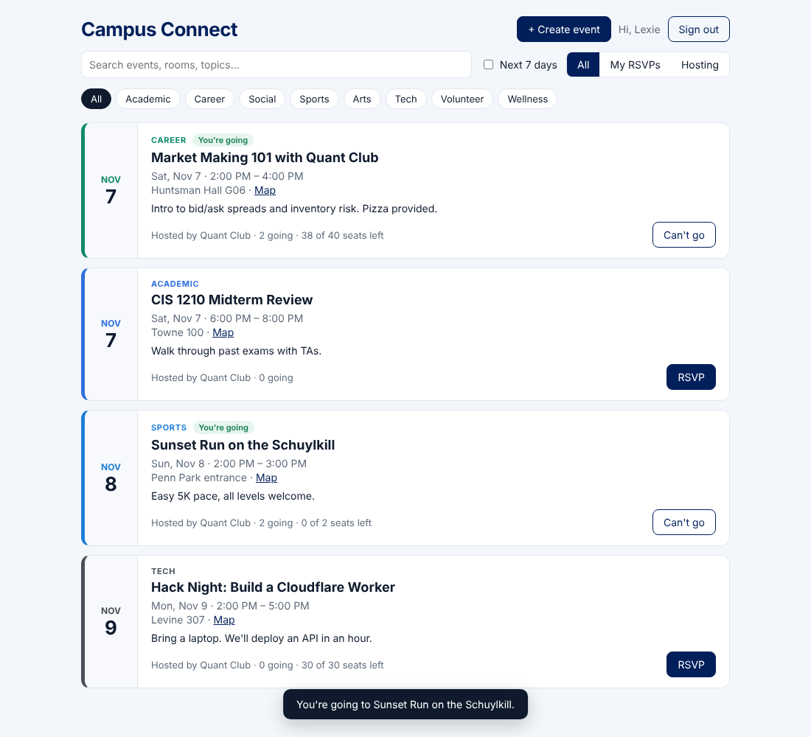
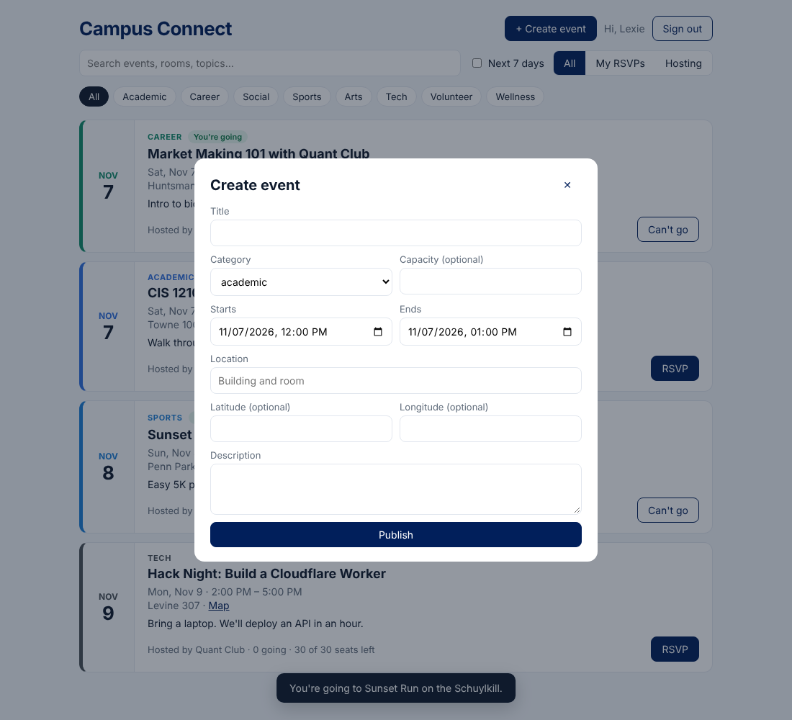

# Campus Connect

Campus event discovery and RSVPs, running on Cloudflare's edge: a Hono API on Workers, Cloudflare D1
(SQLite) for storage, and a React single-page app served as Workers static assets.




## Features

- Browse upcoming events; full-text search over title, description and location; category filter; "next 7 days".
- Create, edit and cancel events (organizer only), with optional coordinates and capacity.
- One-click map links (OpenStreetMap / Google Maps) from coordinates or the location text.
- RSVP with **capacity limits and a FIFO waitlist**; cancelling a seat promotes the next person automatically.
- **Schedule-conflict warnings** when you RSVP to an event that overlaps one you're already attending.
- Personal lists ("My RSVPs", "Hosting") and an **iCalendar (.ics) export** of everything you're attending.

## Engineering notes

**Duplicate-safe, race-free RSVPs.** `rsvps` has a composite primary key `(event_id, user_id)`, so a
double-click or retried request cannot create a second row (`INSERT … ON CONFLICT DO NOTHING`, 201 vs 200).
Seat assignment happens inside that single `INSERT … SELECT`, which counts current attendees and picks
`going` or `waitlist` atomically, so two people cannot take the last seat. Cancelling and promoting the
head of the waitlist run in one `db.batch()` transaction, and the promotion re-checks capacity, so a
waitlisted user leaving never over-fills an event. Raising capacity admits the waitlist in order;
lowering it below current attendance is rejected with 409.

**Parameterized SQL everywhere.** All queries use numbered bind parameters (`?1 … ?N`); dynamic `UPDATE`
column names come from a fixed whitelist. Search escapes `%` and `_` so user input is matched literally.

**Keyset pagination.** Listing orders by `(starts_at, id)` and pages with an opaque cursor encoding the
last row, which stays correct while new events are inserted and uses the `idx_events_starts` index.

**Auth on the edge.** Passwords are hashed with PBKDF2-SHA256 (100k iterations, per-user salt) through
the Web Crypto API, which Workers provide natively, and compared in constant time. Sessions are HS256
JWTs (`hono/jwt`) signed with a Worker secret. Public endpoints accept an optional token so the listing
can show "You're going" without requiring sign-in.

**Validation.** Zod schemas enforce field rules (lengths, category enum, ISO-8601 timestamps with offset,
coordinate ranges) and cross-field rules (end after start, lat/lon given together, no past events),
returning field-level `400` errors.

## Layout

```
worker/
  src/index.ts        Hono routes, error mapping
  src/events.ts       listing (filters, search, keyset cursor), CRUD, map links
  src/rsvp.ts         RSVP state machine: capacity, waitlist, promotion, conflicts
  src/auth.ts         JWT session middleware          src/crypto.ts   PBKDF2 hashing
  src/ics.ts          RFC 5545 export (escaping, 75-octet line folding)
  src/validation.ts   Zod schemas
  migrations/         D1 SQL migrations (CHECK constraints, FKs, indexes)
  test/               Vitest suite; d1-shim.ts runs the real migration + SQL on better-sqlite3
web/                  React 19 + TypeScript + Vite
```

## Run locally

```bash
cd web && npm install && npm run build            # builds the SPA into web/dist
cd ../worker && npm install
cp .dev.vars.example .dev.vars                    # set SESSION_SECRET
npm run db:migrate:local
npm run dev                                        # http://localhost:8787 (API + SPA)
```

For frontend hot reload, run `npm run dev` in `web/` as well (Vite proxies `/api` to port 8787).

## Deploy

```bash
npx wrangler d1 create campus_connect             # put the id in worker/wrangler.toml
npx wrangler secret put SESSION_SECRET
cd web && npm run build && cd ../worker
npm run db:migrate:remote && npm run deploy
```

## Tests

```bash
cd worker && npm test
```

10 test cases covering password hashing, auth flows, field-level validation, category filter + literal
search + cursor pagination, organizer-only edits, duplicate-safe RSVPs, capacity/waitlist/promotion,
capacity changes, conflict detection, personal lists and calendar export, and iCalendar line folding.
CI type-checks and tests the Worker and builds the web app.
