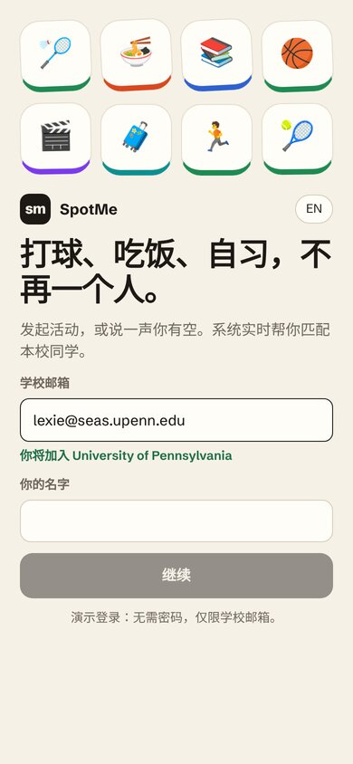
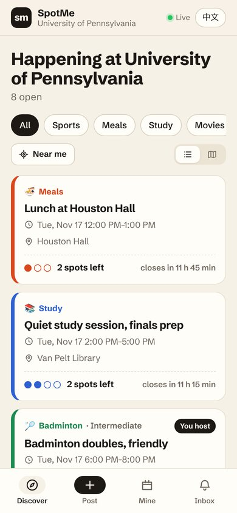
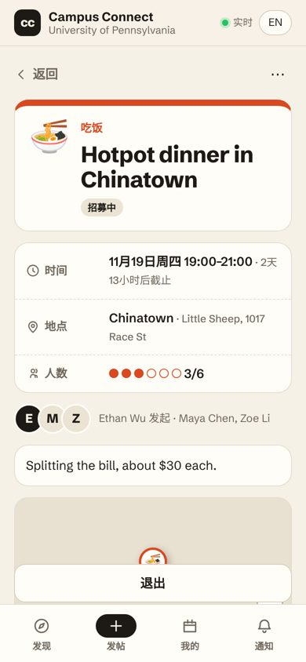
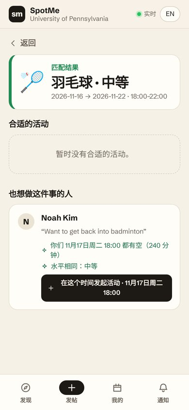
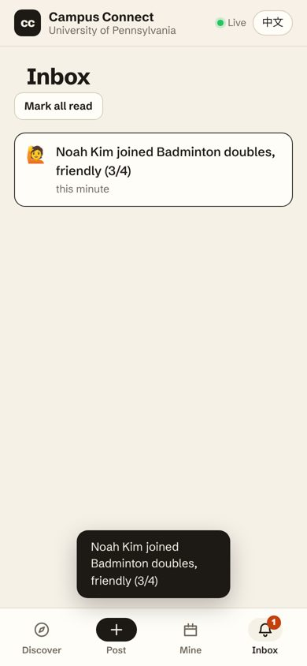
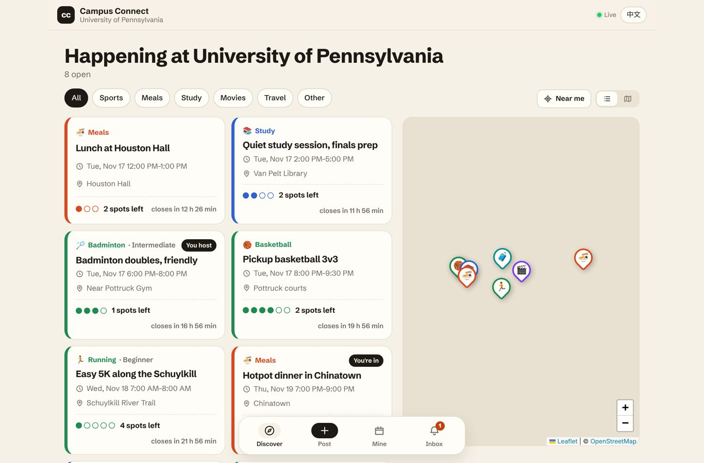

# Campus Connect

Find a buddy at your school, for a game, a meal, a study session, a movie or a trip. Post a plan ("badminton Wednesday 6–8 pm, need 3, fill by 4 pm") or just say you're free ("badminton, weekday evenings this week, intermediate"). Campus Connect matches people at the same school, explains each match, and pushes updates in real time. Works for any university: the email domain decides the school. English and Chinese, mobile first.

| Sign up (中文) | Discover | Plan (中文) | Matches (中文) | Live update |
| --- | --- | --- | --- | --- |
|  |  |  |  |  |



## How it works

- **Two kinds of posts.** An *activity* has a time, a place, a size and a **fill-by deadline**. A *looking-for* post has a category (sports with 12 sports, meals, study, movies, travel), a level for sports, and free time as data: a date range, weekdays and a daily window in the poster's own time zone.
- **Matching.** Hard filters first: same school, same kind (and sport), nobody blocked on either side, a free spot, at least 30 minutes of real overlap with the person's free time, levels at most one step apart, within their distance. Then a weighted score: time fit .40, level .25, distance .25 (`exp(-km/2)`), urgency .10. Weights renormalize when a factor has no data, and every part comes back as a reason ("Wed 6 PM, fully in your free time", "0.3 km away"). A new activity notifies the 20 best-matching people; a new looking-for post lists fitting activities and other people who want the same thing, with your longest common slot in the next 14 days.
- **Fill-by deadline.** A sweep every 30 s moves activities through a state machine. At the deadline joining closes and the host confirms, full or not: *start* with whoever joined, or *cancel*; everyone who joined is told either way. If the host still hasn't decided at the start time, it's cancelled automatically. The host can also start or cancel any time before. Each transition is a conditional update on the current status, so a repeated or concurrent sweep never double-notifies.
- **No overbooking.** Joining is one `findOneAndUpdate` whose filter includes "open, before the deadline, not already in, participants + 1 < capacity", so of eight people racing for the last two spots exactly two get in (tested).
- **Real time.** Socket.IO with a room per user (notifications) and per school (feed changes). Notifications are also stored, so nothing is lost while offline.
- **Nearby.** Activities carry GeoJSON points with a `2dsphere` index; the feed uses `$geoNear` when the browser shares a location. Maps use the Google Maps JavaScript API with Advanced Markers when `GOOGLE_MAPS_API_KEY` is set (pins redraw live as the socket reports changes), and fall back to Leaflet + OpenStreetMap without a key or if Google rejects it.
- **Privacy and safety.** Only verified school emails; posts are visible only within the school. The public post shows a rough area, and the exact spot appears after you join. Blocking is two-way: neither side sees the other's posts, can join them or is matched. Reports are stored for review. Live location is used for the query and not saved.

## Stack

```
server/  Node 22 · Express 5 · TypeScript · MongoDB (Mongoose) · Socket.IO · Zod · JWT (jose)
         Google Identity Services ID-token sign-in · Luxon for time zones
         availability.ts (free time → UTC intervals, DST-safe) · matching.ts (pure scoring)
         services.ts (match, join, leave, host decision, deadline sweep) · realtime.ts
web/     React 19 · Vite · TypeScript · socket.io-client · Google Maps JS API (Leaflet fallback) · en/zh
```

School lookup uses [Hipo/university-domains-list](https://github.com/Hipo/university-domains-list) (MIT), bundled as `server/data/universities.json` (about 10,000 schools; subdomains such as `seas.upenn.edu` resolve to the school).

## Run it

```bash
# MongoDB on localhost:27017 (or set MONGODB_URI)
cd server && npm install && npm run seed:demo -- --reset && npm run dev   # API + socket on :8787
cd web && npm install && npm run dev                                       # UI on :5173
```

Sign in with any `@upenn.edu` address to see the demo data (demo sign-in needs no password and is off in production unless `ALLOW_DEV_LOGIN=true`). Tests: `cd server && npm test`. They run 18 tests (matching, time zones including DST, the API, concurrency, the deadline state machine and a real socket round trip) against an in-memory `mongod`.

| Variable | Purpose |
| --- | --- |
| `MONGODB_URI` | MongoDB connection string (Atlas in production) |
| `CAMPUS_JWT_SECRET` | Session signing key; required in production |
| `GOOGLE_CLIENT_ID` | Enables "Sign in with Google" (Google Cloud OAuth client, web) |
| `GOOGLE_MAPS_API_KEY` | Browser key for the Maps JavaScript API; restrict it to your site's referrer |
| `GOOGLE_MAPS_MAP_ID` | Map ID for Advanced Markers (defaults to Google's `DEMO_MAP_ID`, for testing only) |
| `ALLOW_DEV_LOGIN` | Email-only demo sign-in; defaults to on outside production |
| `PORT` | Defaults to 8787 |

**Deploy**: create a free MongoDB Atlas cluster, then on Render choose **New → Blueprint** with this repo and paste the Atlas URI into `MONGODB_URI`. `render.yaml` builds the web app and serves it from the same Node service.

## Project plan

The plan (users, features, matching, state machine, architecture, milestones) is in Chinese in the project doc; this README tracks what is built.
